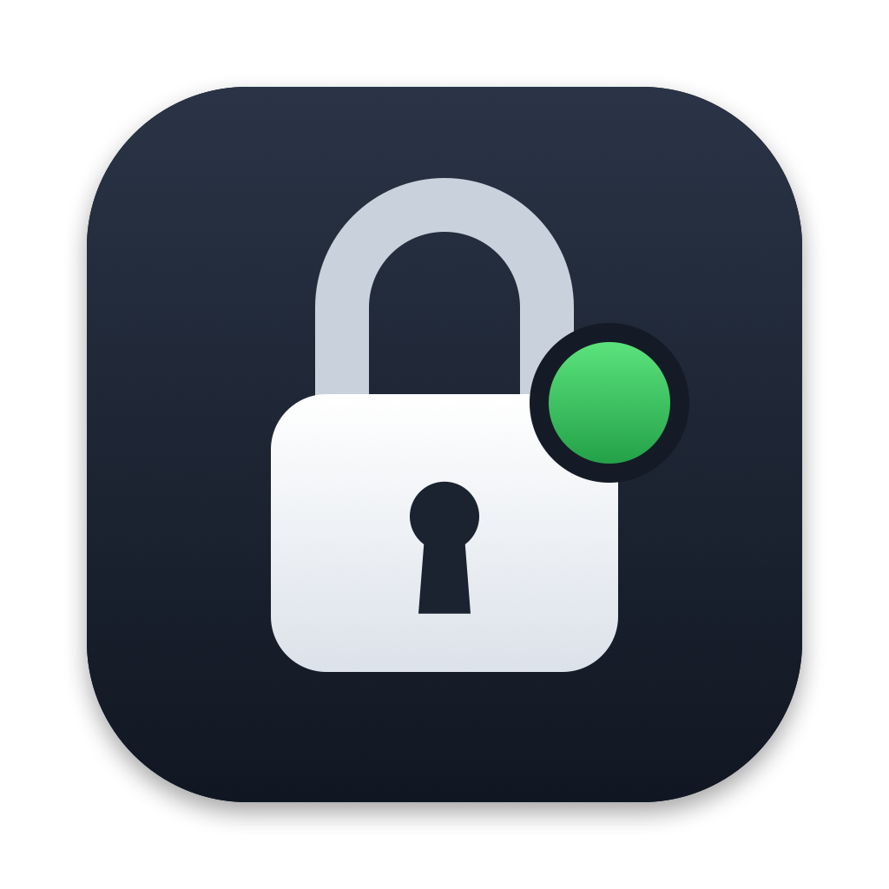

<p align="center">
  
</p>

<h1 align="center">MacLatch</h1>

<p align="center">
  Lock your Mac when you pull your YubiKey. Never get locked out when you don't have it.
</p>

<p align="center">
  
  
  
  
</p>

---

MacLatch is a small native menu bar app. Plug in your YubiKey and it **arms**. Pull it out and,
after a short grace period, your Mac **locks**. That's it.

The YubiKey is **not** an authentication factor. MacLatch doesn't touch login, PAM, FileVault,
smart card pairing or your password. You can always boot, log in, unlock and use your Mac
without the key. The core rule of the project:

> A YubiKey may arm the application. The absence of a YubiKey must never arm the application.

## Features

- **Arms only from your key.** Bound to one specific YubiKey by serial number; other keys are ignored.
- **Locks once, then disarms.** After an automatic lock MacLatch is unarmed, so unlocking with your
  password or Touch ID never leads to a lock loop. Re-insert the key to arm again.
- **Grace period with revalidation.** Choose 0, 1, 3 (default), 5, 10 or 15 seconds. Re-inserting
  the key cancels the lock. Before locking, presence is checked once more.
- **Event-driven.** IOKit notifications, no polling of `ioreg` or `system_profiler`.
- **Monitor Mode** (on by default): everything runs, but the lock is only logged ("Would lock now"),
  so you can test with your hubs, docks and sleep/wake before turning real locking on.
- **Fail-open.** When in doubt, MacLatch does *not* lock. The worst failure is a missed automatic lock.
- **Keep Mac Awake** (optional): prevents idle system sleep like `caffeinate -i`, so long-running
  jobs keep going while the screen is locked.
- **Start at Login** via `SMAppService`, offered once on first launch.
- **No permissions, no network, no telemetry, no dependencies.**

## States

| Menu bar | State | Meaning |
|---|---|---|
| yellow open lock | **Unarmed** | Protection off. Removing a key does nothing. |
| green lock | **Armed** | Your key is attached. Removing it starts the grace period. |
| red lock + "Locking…" | **Locking…** | Key removed. Locks when the grace period ends unless the key comes back. |

Color is never the only signal: each state has its own symbol and text.

```text
UNARMED ──key inserted──▶ ARMED ──key removed──▶ LOCKING…
   ▲                        ▲                       │
   │                        └──key back in time─────┤
   │                                                ▼
   └────────── lock screen exactly once ◀── grace period over, key still absent
```

Also: system sleep disarms (wake re-arms only if the key is verifiably present), and
**Disarm** in the menu stays disarmed until the key is physically re-inserted.
Armed or pending state is never persisted.

## Install

There are no prebuilt releases yet. Build from source; you need macOS 13+ and Swift 6
(Xcode 16+ or the Command Line Tools).

```sh
git clone https://github.com/nel0x/maclatch.git
cd maclatch
scripts/build-app.sh --install   # builds, installs to /Applications and starts it
```

The app is ad-hoc signed for your own machine. To build without installing:
`scripts/build-app.sh` (writes `build/MacLatch.app`).

### First run

1. Insert your YubiKey, open the menu → **Configure YubiKey** → choose your key.
2. The icon turns green. Pull the key: you should see **Locking…** and, in Monitor Mode,
   "Would lock now" under **Recent Events**.
3. Test your setup (direct port, hub, dock, sleep/wake, quick re-plugging).
4. Turn **Monitor Mode** off to enable real locking.

## How it works

- **Presence:** IOKit matching notifications for `IOUSBHostDevice` with Yubico vendor ID `0x1050`.
  MacLatch tracks the physical USB device, not its HID/FIDO/CCID interfaces, so an interface
  reset is not a removal.
- **Identity:** when a key's FIDO HID interface appears, MacLatch reads its serial number once,
  using Yubico's vendor CTAPHID "read config" command. No touch and no Input Monitoring
  permission needed.
- **Arming rule:** a key can only arm if its USB device is visible to the same matching that
  reports removals.
- **Lock:** `SACLockScreenImmediate` from `login.framework`, the mechanism behind
  Apple menu → Lock Screen. It's a private API. If it can't be resolved, MacLatch refuses to arm.
  It never falls back to logout, shutdown or killing processes.
- **State machine:** a Swift `actor` with an explicit `enum` state. Each pending lock timer is
  tied to the removal that started it, so a stale timer can never lock.

## Security model

MacLatch protects against **walking away from an unlocked Mac**, as long as you carry the key
with you (keychain, lanyard). It is not:

- a replacement for FileVault or a strong login password,
- a login or authentication system (no PAM, no smart card login),
- protection against someone who already has your password.

**Deliberate fail-open trade-offs:**

- If an unidentifiable YubiKey is attached when your key is removed, MacLatch can't be sure
  your key is gone and does **not** lock. The menu shows a warning.
- Keys whose FIDO interface is disabled, or with firmware older than 4.1, can't be identified
  and never arm.

To report a vulnerability, see [SECURITY.md](SECURITY.md).

## Compared to macOS's built-in option

macOS can start the screen saver when a paired smart card is removed (System Settings →
Privacy & Security → Advanced → "Turn on screen saver when login token is removed", or
`tokenRemovalAction` via MDM). With a YubiKey this requires PIV certificates and pairing the key
with your account, which ties it into login and Keychain. MacLatch needs neither. It works with
keys you only use for FIDO/2FA, and it adds a grace period, revalidation and a Monitor Mode.
If you already use PIV smart card login, the built-in option may be all you need.

## Development

```sh
swift test   # state machine, device tracking, CTAPHID framing, device info parsing
```

```text
Sources/MacLatchCore/       pure logic, no AppKit/IOKit, fully unit-tested
  GuardStateMachine.swift     the security state (actor)
  GuardState.swift            states, events, snapshots
  Dependencies.swift          LockService, KeyPresenceChecker, timer abstraction
  DeviceTracker.swift         USB device ↔ identity, configured-key filtering, revalidation
  CTAPHID.swift               FIDO HID framing
  YubiKeyDeviceInfo.swift     device info parsing
Sources/MacLatch/           menu bar app: AppKit UI, IOKit monitor, lock backend
Tests/MacLatchCoreTests/
```

Logs: `log stream --predicate 'subsystem == "io.github.nel0x.maclatch"' --level info`

Before contributing, read [AGENTS.md](AGENTS.md) (rules and invariants) and
[PROJECT.md](PROJECT.md) (original specification, in German). Security-relevant
changes need tests and must keep the Mac fully usable without the key.

## License

[MIT](LICENSE) © nel0x
